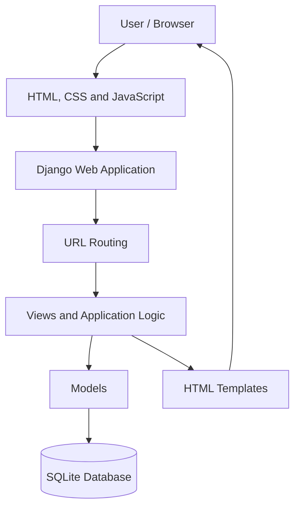
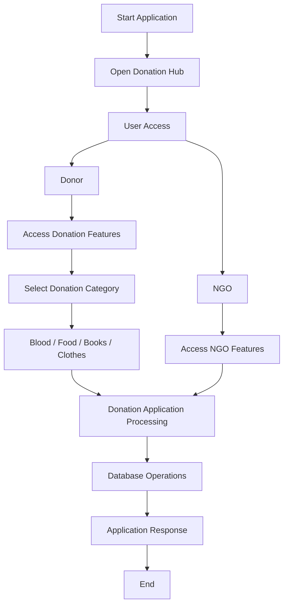

# ❤️ Smart Donation Hub

### Connecting Donors and NGOs Through Technology to Make Donations Easier and More Accessible

<p align="center">
  
  
  
  
  
</p>

---

## 📌 1. Project Overview

**Smart Donation Hub** is a web-based donation management platform developed to simplify the process of connecting donors with Non-Governmental Organizations (NGOs).

Many individuals are willing to contribute to society by donating essential resources such as blood, food, books, and clothes. However, finding suitable organizations and coordinating donations can sometimes be challenging.

Smart Donation Hub aims to provide a centralized digital platform where donors and NGOs can participate in donation-related activities.

The application provides separate user roles for donors and NGOs, allowing them to interact with the donation management system.

By using Django for backend development and HTML, CSS, and JavaScript for the frontend, the project demonstrates how web technologies can be used to support social welfare initiatives.

## 🎯 2. Project Objectives

The primary objectives of Smart Donation Hub are:

- Create a centralized platform for donation management.
- Connect donors with NGOs.
- Simplify the process of contributing essential resources.
- Support multiple donation categories.
- Provide separate interfaces for donors and NGOs.
- Improve accessibility to donation-related information.
- Reduce the complexity of coordinating donations.
- Use web technology to encourage community participation and social responsibility.

## ❗ 3. Problem Statement

Donation activities often involve coordination between individuals willing to donate and organizations responsible for distributing donated resources.

Traditional donation processes may require individuals to independently identify organizations, contact them, understand their requirements, and coordinate the donation process.

This can create difficulties such as:

- Lack of centralized donation information.
- Difficulty finding suitable donation opportunities.
- Time-consuming coordination between donors and NGOs.
- Limited accessibility to donation-related services.
- Challenges in organizing different donation categories.

There is a need for a centralized digital platform that simplifies donation-related activities and improves communication between donors and NGOs.

Smart Donation Hub addresses this problem by providing a web-based system for organizing and managing donation activities.

## 💡 4. Proposed Solution

Smart Donation Hub provides an online platform where donors and NGOs can participate in donation-related activities.

The application is organized around two primary user roles:

### 4.1 Donor

Donors are individuals who want to contribute resources to support people in need.

The platform provides a donor-oriented interface for participating in donation activities.

Supported donation categories include:

- Blood
- Food
- Books
- Clothes

### 4.2 NGO

NGOs are organizations involved in social welfare and charitable activities.

The platform provides an NGO-oriented interface to support participation in donation management activities.

The overall objective is to make the donation process more organized and accessible.

## ✨ 5. Key Features

| Feature | Description |
|---|---|
| Donor Role | Provides an interface for individuals participating in donation activities. |
| NGO Role | Provides an interface for NGOs participating in the platform. |
| Blood Donation | Supports blood donation-related activities. |
| Food Donation | Supports food donation-related activities. |
| Books Donation | Supports book donation-related activities. |
| Clothes Donation | Supports clothing donation-related activities. |
| Web-Based Interface | Allows users to interact with the platform through a browser. |
| Database Integration | Uses SQLite for storing application data. |
| Django Backend | Handles server-side application functionality. |

## 🏗️ 6. System Architecture

The application follows a Django-based web architecture.



### Architecture Explanation

**1. Presentation Layer**

HTML, CSS, and JavaScript provide the user interface through which donors and NGOs interact with the application.

**2. Application Layer**

Django handles incoming requests, URL routing, server-side processing, and application functionality.

**3. Data Layer**

Django models interact with the SQLite database to store and retrieve application information.

**4. Template Layer**

Django templates generate the HTML pages displayed to users.

## 🔄 7. Application Workflow



This diagram illustrates the conceptual workflow of the platform.

## 🛠️ 8. Technology Stack

| Technology | Purpose |
|---|---|
| Python | Main backend programming language. |
| Django | Backend web framework. |
| HTML5 | Structure of web pages. |
| CSS3 | Styling and layout. |
| JavaScript | Client-side interactions. |
| SQLite | Relational database management. |
| Git | Version control. |
| GitHub | Source code hosting and collaboration. |

## 📂 9. Project Structure

The repository is organized into the following directories and files:

```text
donation_hub/
│
├── donation/
│   └── Donation application files
│
├── smart_donation/
│   └── Django project configuration
│
├── static/
│   └── images/
│       └── Static image resources
│
├── templates/
│   └── HTML templates
│
├── db.sqlite3
│   └── SQLite database
│
├── manage.py
│   └── Django management utility
│
└── README.md
```

### Directory Explanation

| File / Directory | Description |
|---|---|
| `donation/` | Contains the main donation application and its related functionality. |
| `smart_donation/` | Contains Django project-level configuration and application settings. |
| `static/` | Stores static resources used by the application. |
| `static/images/` | Contains image assets. |
| `templates/` | Contains HTML templates used to render application pages. |
| `db.sqlite3` | SQLite database file. |
| `manage.py` | Django command-line utility used to manage the application. |
| `README.md` | Project documentation. |

## 💻 10. Prerequisites

Before installing and running the project, make sure you have the following:

| Requirement | Purpose |
|---|---|
| Python 3.x | Execute the Django application. |
| pip | Install Python dependencies. |
| Git | Clone the repository. |
| Web Browser | Access the application. |
| Code Editor | Recommended: Visual Studio Code. |

You can verify Python installation using:

```bash
python --version
```

Verify pip:

```bash
pip --version
```

Verify Git:

```bash
git --version
```

## ⚙️ 11. Installation and Setup

Follow these instructions to configure and run Smart Donation Hub on your local machine.

### Step 1: Clone the Repository

Open your terminal or Git Bash and execute:

```bash
git clone https://github.com/AtharvY11/donation_hub.git
```

### Step 2: Navigate to the Project Directory

```bash
cd donation_hub
```

### Step 3: Create a Virtual Environment

Creating a virtual environment helps isolate project dependencies.

```bash
python -m venv venv
```

### Step 4: Activate the Virtual Environment

**Windows:**

```bash
venv\Scripts\activate
```

**Linux / macOS:**

```bash
source venv/bin/activate
```

### Step 5: Install Django

The repository does not currently expose a requirements file in its root directory.

Install Django:

```bash
pip install django
```

If the application imports additional third-party packages, install those dependencies as well.

### Step 6: Apply Database Migrations

Execute:

```bash
python manage.py makemigrations
```

Then:

```bash
python manage.py migrate
```

These commands prepare the SQLite database according to the application's Django models.

### Step 7: Start the Development Server

Run:

```bash
python manage.py runserver
```

### Step 8: Open the Application

Open your browser and visit:

```text
http://127.0.0.1:8000/
```

The Django development server will make the application accessible locally.

**Note:** The exact route displayed depends on the URL configuration implemented in the project.

## ▶️ 12. Running the Project

After starting the Django development server:

1. Open the application in your browser.
2. Access the available application pages.
3. Select the appropriate user role.
4. Explore the available donation categories.
5. Interact with the application's donation-related functionality.

The available operations depend on the implemented Django views, templates, and database models.

## 🗄️ 13. Database Management

Smart Donation Hub uses SQLite as its database.

SQLite is a lightweight relational database that stores application data in a local database file.

The repository contains:

```text
db.sqlite3
```

Django provides an Object-Relational Mapper (ORM) to interact with database records through Python models.

### Database Migrations

Whenever model definitions change, migrations can be generated using:

```bash
python manage.py makemigrations
```

Apply migrations using:

```bash
python manage.py migrate
```

### Django Administration

To create a Django superuser, execute:

```bash
python manage.py createsuperuser
```

If the Django admin interface is configured, it can generally be accessed at:

```text
http://127.0.0.1:8000/admin/
```

## 🔐 14. Security Considerations

For a production deployment, the following security practices are recommended:

- Keep Django's secret key outside publicly accessible source code.
- Set `DEBUG = False` in production.
- Configure appropriate allowed hosts.
- Use secure authentication and authorization.
- Validate user inputs.
- Protect sensitive user information.
- Configure secure database backups.
- Use HTTPS for production deployments.

## 🧪 15. Testing and Verification

After setting up the application, verify the following:

| Test | Expected Verification |
|---|---|
| Application Startup | Django development server starts successfully. |
| Homepage | Application homepage loads. |
| User Interface | HTML templates and static resources load correctly. |
| Donor Access | Donor-related pages and functionality work. |
| NGO Access | NGO-related pages and functionality work. |
| Donation Categories | Available donation categories are accessible. |
| Database | Database operations execute successfully. |
| Navigation | Application pages can be accessed through their configured routes. |

These checks can help identify configuration and runtime issues during local development.

## ⚠️ 16. Troubleshooting

### Issue 1: No module named Django

**Solution:**

```bash
pip install django
```

Ensure that the virtual environment is activated.

### Issue 2: Database Table Does Not Exist

**Solution:**

```bash
python manage.py makemigrations
python manage.py migrate
```

### Issue 3: Port Already in Use

Start the server using another port:

```bash
python manage.py runserver 8001
```

### Issue 4: Static Images Not Loading

Verify:

- Static file paths.
- Static directory configuration.
- Template image references.
- Django static file settings.

### Issue 5: TemplateDoesNotExist

Verify that the template exists and that Django's template configuration points to the correct directory.

### Issue 6: Page Not Found (404)

Check the project's URL configuration and ensure the requested URL is mapped to an appropriate view.

## 🚀 17. Future Enhancements

Potential improvements for Smart Donation Hub include:

- Online payment gateway integration.
- Real-time donation notifications.
- Donation history and tracking.
- NGO verification mechanisms.
- Advanced donor and NGO dashboards.
- Donation analytics and reporting.
- Email notifications.
- Improved mobile responsiveness.
- Location-based donation discovery.
- Administrative monitoring and reporting.

These are potential enhancements and are not necessarily part of the current implementation.

## 🤝 18. Contributing

Contributions and suggestions are welcome.

To contribute:

1. Fork the repository.
2. Create a new feature branch.
3. Implement your changes.
4. Test your implementation.
5. Commit your changes.
6. Submit a pull request.

## 📄 19. License

No explicit license information has been verified in the repository.

If you plan to distribute the project as open-source software, consider adding an appropriate LICENSE file.

## 👨‍💻 20. Author

**Atharv Yarandole**

MCA Student | Aspiring Software Developer | AI/ML & Full-Stack Development Enthusiast

- GitHub: [@AtharvY11](https://github.com/AtharvY11)
- Repository: [Smart Donation Hub](https://github.com/AtharvY11/donation_hub)

---

<p align="center">
  <h3>❤️ Technology for a Better Tomorrow</h3>
  <p>Connecting people who want to help with organizations that make a difference.</p>
  <b>Developed with ❤️ by Atharv Yarandole</b>
</p>
